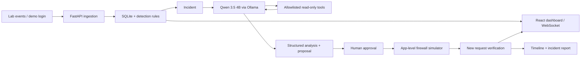

# แผนพัฒนา SENTINEL AI

เป้าหมายการส่งมอบคือระบบ local SOC ที่แสดงข้อมูลจริงตั้งแต่รับ event จนถึง verification และมีหลักฐานทดสอบสำหรับสอบวันที่ 6 พฤศจิกายน 2569 งานแบ่งตามความรับผิดชอบและ dependency คนที่ว่างสามารถรับแทนได้

## สถาปัตยกรรม

Detection เป็นกฎที่ตรวจสอบซ้ำได้ โมเดลอ่านหลักฐานและเสนอคำแนะนำ Backend ตรวจ policy และสร้างกฎหลังคนอนุมัติเท่านั้น Tool allowlist มีขอบเขตการอ่าน ไม่เปิด shell ให้โมเดล

## การแบ่งคน

| คน | รับผิดชอบหลัก | จุดส่งต่อ |
|---|---|---|
| พิชชากร | Event/API contract, backend, database, detection, Agent integration, approval/firewall, verification, report | ส่ง schema และ endpoint ให้ ประภากรณ์ |
| ประภากรณ์ | Frontend/UI, Qwen baseline, prompt tuning, model evaluation, fine-tune เมื่อทรัพยากรพอ | ส่ง model tag/prompt/ผลวัดให้ พิชชากร |

## Phase 0 — กำหนดข้อตกลงและพิสูจน์เครื่องมือ

พิชชากร ตรวจ `docs/api-contract.md` และ OpenAPI ให้ field/status/error ตัวอย่างตรงกับของจริง ทำ B00 ให้ทั้งคู่ใช้ร่วมกัน ประภากรณ์ ตรวจ F00 UI shell และ M00 ด้วย `qwen3.5:4b` บันทึก GPU, Ollama version, model ID, latency, GPU memory, JSON validity และ tool selection

ผ่านเมื่อทั้งคู่รันโครงแอปบน checkout ตัวเองได้, อ่าน contract ตรงกัน, รู้ว่าโมเดลทำงานจริงหรือยังมีข้อจำกัด ห้ามนับ fallback เป็นผลจาก Qwen

## Phase 1 — รับข้อมูลและตรวจจับ

พิชชากร ทำ B01 ingestion/SQLite, B02 rule detection, B03 endpoint demo ข้ามเครื่องตามลำดับ ประภากรณ์ ทำ F01 โดยใช้ contract ของ B00 และของจริงเมื่อ backend พร้อม

ตรวจ normal traffic ไม่เกิด incident, HTTP/SSH แยกชนิด, failure ครั้งที่ 4 ไม่เตือน/ครั้งที่ 5 เตือนภายใน 60 วินาที, connection 8 พอร์ตต่างกันเป็น port scan, log เดิมไม่สร้าง incident ซ้ำ และ restart แล้วยังมี records

ผ่านเมื่อ UI แสดง incident จาก backend และ source IP สอดคล้องกับข้อมูลต้นทาง ใน LAN ใช้ IP จริงของ request แยกจาก IP จำลองบน localhost

## Phase 2 — สืบสวนด้วยโมเดลและเครื่องมือ

พิชชากร ทำ B04 เชื่อม Ollama/structured output และ B05 allowlisted tool workflow ประภากรณ์ ทำ F02 evidence/trace viewer และ M01 prompt tuning/evaluation

โมเดลหลักคือ `qwen3.5:4b` เริ่ม context 4096 ตาม config ของ MVP เพิ่ม context หลังวัดหน่วยความจำจริง แยก train/development/test incidents ก่อนปรับ prompt และไม่ใช้ test set เลือกค่าที่ดีที่สุด

ทดลอง fine-tune เฉพาะหลัง baseline ใช้ได้และมีทรัพยากรจริง ถ้าทำ ให้เก็บข้อมูล, training config, seed, adapter/model artifact reference และเทียบผลกับ baseline หากทำไม่ได้ให้บันทึกเหตุผล ผล prompt tuning และข้อจำกัด ห้ามเรียก prompt tuning ว่า fine-tuning

ผ่านเมื่อ model output validate ได้, trace มี tool ที่เลือกและเรียกจริง, คำแนะนำมีหลักฐาน และ outage/invalid output ถูกระบุเป็น fallback/error อย่างตรงไปตรงมา

## Phase 3 — อนุมัติ ป้องกัน และพิสูจน์ผล

พิชชากร ทำ B06 policy/approval/rule expiry และ B07 WebSocket/verification ประภากรณ์ ทำ F03 หน้าตรวจข้อเสนอและ before/after

ทดสอบ pending ยังไม่บล็อก, Approve สร้างกฎครั้งเดียว, Reject ไม่มี rule, protected IP ถูกปฏิเสธ, request ใหม่จาก IP เดิมได้ HTTP 403 หลัง Approve, หมดอายุหรือ unblock แล้วผ่านได้ และ timeline อ้าง records จริง

ผ่านเมื่อ verification เกิดหลัง request ใหม่ที่ถูกปฏิเสธจริง การตรวจว่ามีกฎอยู่เพียงอย่างเดียวไม่พอ

## Phase 4 — รวมระบบ ประเมิน และซ้อมสอบ

พิชชากร ทำ B08 dataset/metrics/report และ B09 ซ้อม LAN ประภากรณ์ ทำ F04 API/WebSocket integration และ F05 UI polish/หลักฐานสไลด์

ประภากรณ์ เพิ่ม F06 deployment ตาม `docs/deployment-plan.md`: URL HTTPS จริง, production API/WSS configuration, access control ร่วมกับ พิชชากร, smoke test จากเครื่องอื่น และคู่มือ rollback แนะนำ Vercel Hobby สำหรับ frontend และ local GPU backend ผ่าน protected tunnel ยังไม่นับว่า deploy แล้วจนทดสอบ URL จริงผ่าน

เตรียม normal/attack labeled cases ที่แยกจากการพัฒนา วัด TP/FP/FN/TN, precision, recall, F1, false-positive rate และ AI JSON/tool validity/latency เก็บจำนวนตัวอย่าง วิธีสร้างข้อมูล hardware/model tag และคำสั่งทำซ้ำ สถิติ IP ของหน้า Reports ใน MVP เป็นเพียง exploratory snapshot

ทดสอบ reload/reconnect, restart, offline, Ollama timeout, rejected action, rule expiry และสถานการณ์ใหม่หลังเดโมรอบแรก ถ่ายภาพจากระบบจริงและทำสไลด์ไม่เกิน 10 หน้า: problem, objectives, system, local AI, workflow, dashboard, demo, testing, limitations, conclusion

## กำหนดเวลาประมาณการ

ประมาณ 12–16 วันทำงานสำหรับสองคนที่มีเวลาลงมือสม่ำเสมอและมีโครง MVP นี้เป็นฐาน ไม่รวมการรอแก้ driver/model training ที่ไม่ผ่าน ควรใช้วันที่เป็นจุดตรวจรับและปรับตามเวลาของทีม

| ช่วงเสนอ | เป้าหมาย |
|---|---|
| 16–18 ต.ค. | Phase 0 และยืนยัน scope |
| 19–22 ต.ค. | Phase 1 |
| 23–26 ต.ค. | Phase 2; ตัดสินใจ fine-tune จากผลจริง |
| 27–29 ต.ค. | Phase 3 |
| 30 ต.ค.–2 พ.ย. | Phase 4 และผลทดสอบ |
| 3–5 พ.ย. | ซ้อมเดโม แก้ bug สำรองข้อมูล/วิดีโอ |
| 6 พ.ย. | นำเสนอ |

## กติกาทำงานกับ Git

1. ทั้งคู่ clone repository คนละ checkout และ pull ก่อนเริ่มงาน
2. ใช้ feature branch ของงานที่รับ สร้าง commit ขนาดที่อ่านตรวจได้
3. เปิด pull request เข้า `dev` ต้องผ่าน CI (backend + frontend) และได้ approve จาก code owner อีกคนก่อน merge
4. รวม `dev` เข้า `main` เมื่อ contract, tests และการทดสอบระบบจริงผ่าน หาก contract เปลี่ยนให้แก้เอกสารและทั้งสองฝั่งพร้อมกัน

## เกณฑ์พร้อมนำเสนอ

- Local Qwen ทำงานจริงและมีผล baseline; fallback ติดป้ายชัด
- Backend/UI เปิดจากคำสั่งใน README ได้บน checkout ใหม่
- Event→incident→tool evidence→proposal→approval→denial→report ครบ
- Approve/Reject/protected IP/expiry/restart/reconnect ผ่าน
- เดโมเพื่อนใน private LAN สองเครื่องผ่านจริง
- มี labeled evaluation, ข้อจำกัด, runbook และภาพ/สไลด์จากระบบจริง

